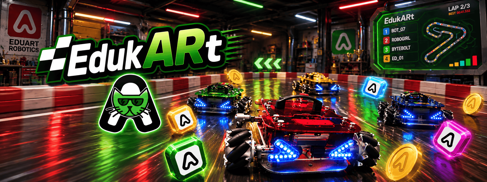

import styles from './edukart.module.css';
import introVideo from './assets/videos/INSTA_1_TikTok_5MB.mp4';
import introPoster from './assets/videos/INSTA_1_TikTok_5MB.jpg';

# EdukARt Spiel

**Reale Roboter. Virtuelle Rennstrecken.** EdukARt ist ein Augmented-Reality-Spiel mit einem echten Roboter: Auf deinem iPhone siehst du virtuelle Rennstrecken, Münzen, Items und Hindernisse in deiner realen Umgebung. Gleichzeitig steuerst du einen Roboter, der tatsächlich vor dir fährt. Die Spielidee lässt sich als Mischung aus **Pokémon GO und Mario Kart** beschreiben – mit Robotik zum Anfassen.

EdukARt entstand als **Bachelorarbeit im Studiengang Media Engineering an der Technischen Hochschule Nürnberg Georg Simon Ohm**. Inzwischen wird es als Projekt im **Master of Applied Research (MAPR)** weiterentwickelt. Dabei stehen neue Roboter, Spielmodi und die Erfahrungen der Spielerinnen und Spieler im Mittelpunkt.

Mehr zum Projekt, Videos und Einblicke in die Entwicklung findest du auf der [EdukARt-Website von Sinamatic](https://sinamatic.de/edukart/).

## Einblick ins Spiel

Das Video zeigt dir, wie echte Roboter und virtuelle Spielelemente in EdukARt zusammenkommen.

<video
  className={styles.video}
  controls
  playsInline
  preload="metadata"
  poster={introPoster}
  aria-label="EdukARt: Einblick ins Mixed-Reality-Rennen"
>
  <source src={introVideo} type="video/mp4" />
  Dein Browser unterstützt die Videowiedergabe nicht. <a href={introVideo}>EdukARt-Video öffnen</a>.
</video>

## Plattformen und aktueller Stand

EdukARt ist aktuell für **Apple-Geräte optimiert**. Die verfügbare iOS-Testversion wird auf dem iPhone über TestFlight installiert. Eine Android-Version soll später folgen; einen festen Termin gibt es dafür noch nicht.

Du kannst das Spiel bereits **ohne echten Roboter** ausprobieren: Dafür steht ein virtueller AR-Roboter im Spiel zur Verfügung. Für Fahrten mit einem echten Roboter kommt bisher die [R&D Plattform Eduard](https://www.eduart-robotik.com/products/rd-platform-eduard) zum Einsatz.

Eine Anleitung für einen selbst gebauten Roboter folgt bald. Der Roboter soll sich mit 3D-gedruckten Teilen nachbauen und in das Spiel einbinden lassen. Den Stand dazu findest du unter [Baue deinen Roboter](./3_edukart-baue-deinen-roboter.md).

Die Installation über TestFlight findest du in der [Spielanleitung](./2_edukart-spielanleitung.md#spiel-installieren).

## EdukARt auf der Consumenta

Auf der **Consumenta vom 31. Oktober bis 8. November 2026 in Nürnberg** wurde EdukARt zum ersten Mal auf einer Messe ausprobiert. In der dort eingesetzten ersten Testversion standen drei vorbereitete Strecken zur Verfügung, damit sich die Spielerlebnisse vergleichen ließen.

<figure className={styles.eventImage}>

</figure>

**Vielen Dank an alle, die EdukARt auf der Consumenta getestet haben!** Eure Rückmeldungen, Wünsche und Ideen helfen dabei, das Spiel weiterzuentwickeln. Ich bin gerade dabei, eure Anregungen einzubauen und EdukARt mit euren Erfahrungen zu verbessern.

Du möchtest sehen, wie sich das Spiel fährt? Das [Consumenta-Video auf YouTube](https://www.youtube.com/watch?v=vkYjHx7WTm8) zeigt die vorhandenen Strecken und das Gameplay ungeschnitten.

<iframe
  className={styles.youtubeVideo}
  src="https://www.youtube-nocookie.com/embed/vkYjHx7WTm8"
  title="EdukARt auf der Consumenta 2026 – Strecken und Gameplay"
  loading="lazy"
  allow="encrypted-media; picture-in-picture; fullscreen"
  referrerPolicy="strict-origin-when-cross-origin"
  allowFullScreen
/>

## Deine Erfahrungen sind gefragt

Was läuft gut, was ist noch unklar und was wünschst du dir für das Spiel? Teile dein Spielerlebnis in der [Online-Umfrage zu EdukARt](https://www.umfrageonline.com/c/btxxap4r). Fehler und weitere Hinweise kannst du auch über TestFlight melden.

## Die Anleitungen im Überblick

- **[Spielanleitung](./2_edukart-spielanleitung.md):** Spiel installieren, AprilTags vorbereiten, den Raum kartieren, die Strecke ausrichten und losfahren.
- **[Baue deinen Roboter](./3_edukart-baue-deinen-roboter.md):** Hier entsteht die Bauanleitung für deinen eigenen echten Roboter.
- **[Eigenen Roboter verwenden](./4_edukart-eigenen-roboter-verwenden.md):** Informationen zur ROS2-Python-Bridge und zur geplanten Konfiguration deines Roboters in der App.
