import styles from './edukart.module.css';

# Spielanleitung

In EdukARt fährst du mit einem echten Roboter durch eine virtuelle Rennstrecke in deiner Umgebung. Für einen ersten Versuch kannst du auch den **AR-Roboter im Spiel** verwenden. Ziel ist es, die Strecke möglichst schnell zu absolvieren und dabei Items und Hindernisse geschickt zu nutzen.

## Was du brauchst

- Ein iPhone mit installierter EdukARt-Testversion. Die Installationsschritte findest du direkt im nächsten Abschnitt.
- Platz zum Spielen und eine freie Fahrfläche für den echten Roboter.
- AprilTags als Orientierungspunkte für die Karte und die virtuelle Strecke.
- Optional einen echten Eduard-Roboter. Zum Ausprobieren genügt der AR-Roboter.

## Spiel installieren

1. Öffne auf deinem iPhone den [EdukARt-TestFlight-Link](https://testflight.apple.com/join/A8TtZRYe).
2. Falls TestFlight noch nicht installiert ist, installiere zunächst Apples **TestFlight-App** und öffne den Einladungslink anschließend erneut.
3. Folge den Hinweisen in TestFlight, um am Test teilzunehmen und **EdukARt** zu installieren. Die Verfügbarkeit und Geräteanforderungen findest du direkt dort.
4. Öffne EdukARt. Erlaube den Kamerazugriff, wenn die App danach fragt, damit sie die Umgebung und die AprilTags erfassen kann.
5. Bereite anschließend die AprilTags vor und folge den Schritten unten, um deine erste Strecke auszurichten und loszufahren.

EdukARt befindet sich in Entwicklung. Funktionen und Bedienoberflächen können sich zwischen Testversionen verändern. Hinweise zur Verarbeitung von Daten findest du im [Datenschutz der EdukARt-App](https://sinamatic.de/edukart/datenschutz/).

<figure>

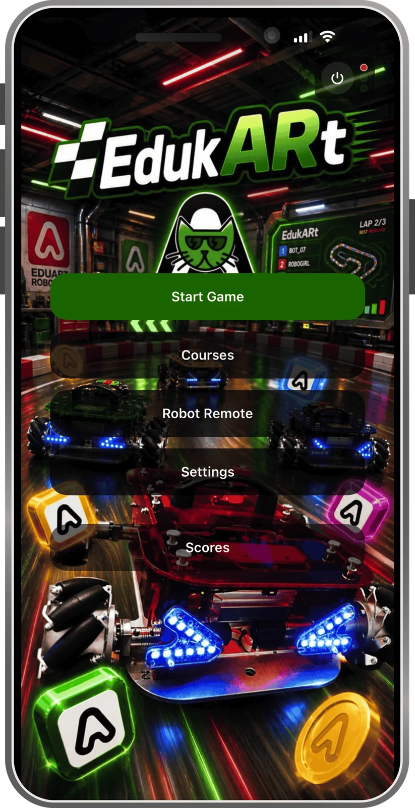

<figcaption>Das Hauptmenü von EdukARt.</figcaption>
</figure>
<figure>

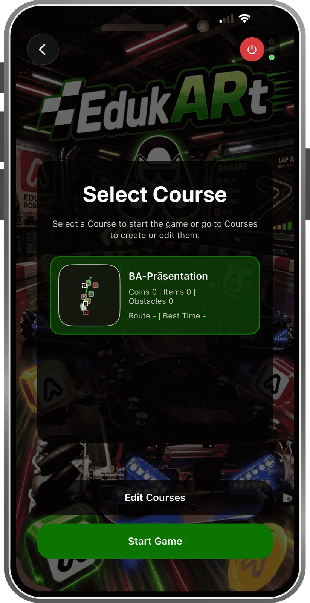

<figcaption>Karte und räumliche Orientierung.</figcaption>
</figure>

## 1. AprilTags vorbereiten

AprilTags sind gedruckte Markierungen, mit denen die App räumliche Bezugspunkte erfasst. Lade eine der Vorlagen herunter:

- [AprilTags zum Ausdrucken als PDF](./assets/files/AprilTags_black96mm_0-39.pdf)
- [AprilTags für den 3D-Druck als 3MF-Datei](./assets/files/AprilTags_w120-b96_0-40.3mf)

Verteile die Tags im Raum und befestige sie so, dass sie während des Spielens an ihrem Platz bleiben. Halte die Fahrfläche frei und achte darauf, dass du die Markierungen mit der iPhone-Kamera erfassen kannst.

Empfehlenswert ist ein **Abstand von weniger als 3 Metern zwischen benachbarten Tags**. Ihre Platzierung dient dazu, eine Karte des Raums zu erstellen: Die Tags müssen weder den Streckenverlauf nachzeichnen noch an Start, Ziel oder jeder Kurve liegen.

:::important Tags dauerhaft fixieren
Wenn AprilTags nach dem Erstellen der Karte verrutschen oder verdreht werden, kann die gespeicherte Strecke nicht mehr zuverlässig im Raum lokalisiert werden. Ihre Position und Ausrichtung müssen deshalb auch zwischen den Spielrunden erhalten bleiben.
:::

Gerade in Zeiten von Staubsaugerrobotern empfehlen sich **3D-gedruckte AprilTags, die du mit doppelseitigem Klebeband fixierst**. So bleiben die Bezugspunkte deiner gespeicherten Strecken auch beim nächsten Putzen an ihrem Platz und du kannst die Strecken später wieder zuverlässig verwenden.

Du möchtest 3D-gedruckte AprilTags bei uns kaufen? Melde dich unter [hello@sinamatic.de mit dem Betreff „Anfrage zu 3D-gedruckten AprilTags für EdukARt“](mailto:hello@sinamatic.de?subject=Anfrage%20zu%203D-gedruckten%20AprilTags%20f%C3%BCr%20EdukARt).

**Markiere die rechte untere Ecke jedes Tags blau**, wie in der [Printvorlage](./assets/files/AprilTags_black96mm_0-39.pdf). Daran erkennst du, wie herum der Tag liegen soll. Besonders der zuerst erkannte Tag muss richtig herum liegen: Seine Drehung bestimmt die Ausrichtung der gesamten Karte.

Für eine kleine Strecke genügen zwei oder drei AprilTags. Auch beim Spielen mit dem virtuellen AR-Roboter werden sie zum Erstellen und Ausrichten der Strecke benötigt.

## 2. Eine Karte erstellen

1. Wähle den Tag, den du zuerst scannen möchtest, und prüfe seine Ausrichtung: **Die blaue Ecke muss rechts unten liegen.**
2. Erfasse diesen Tag mit der iPhone-Kamera. Der **erste erkannte Tag wird zum Referenztag** und ist in der Karte **rot markiert**. Er legt den Ursprung der Karte fest; seine Drehung bestimmt deren Ausrichtung.
3. **Prüfe die Orientierung in der Karte**, bevor du die übrigen Tags erfasst. Der Referenztag darf an einer beliebigen Stelle im Raum liegen und muss auf der Karte nicht unten liegen.
4. Scanne anschließend die weiteren AprilTags, um die Karte deiner Umgebung zu vervollständigen.

**Merke dir, welcher Tag der Referenztag ist, sowie seine Nummer und Position.** Du musst später genau diesen Tag erneut scannen, um die gespeicherte Karte mit der Strecke wieder im Raum zu platzieren.

### Die Strecke einzeichnen

Die gescannten Tags bilden die **Raumkarte**, in die du deine Strecke anschließend von Hand einzeichnest. Du kannst mit denselben fest platzierten Tags unterschiedliche Strecken erstellen. Neue Tags brauchst du erst, wenn du weitere Orte oder Bereiche ausstatten möchtest.

Zeichne die Strecke **in einem Schwung**, also mit einer durchgehenden Fingerbewegung vom Start bis zum Ziel. Der **Start ist gelb**, das **Ziel ist grün** markiert. Die gezeichnete Linie zeigt den Verlauf dazwischen als **Farbverlauf von Gelb nach Grün**.

**Runden werden derzeit noch nicht unterstützt.** Zeichne deshalb einen Streckenverlauf von einem Start zu einem Ziel.

:::tip Beispiel
Du verteilst im Wohnzimmer AprilTags rund um das Sofa, dann hinter dem Esstisch und den Flur entlang bis in die Küche. Zwischen benachbarten Tags lässt du jeweils weniger als 3 Meter Abstand und befestigst alle Tags dauerhaft.

- **Strecke „Wohnzimmer“:** Du scannst zuerst den Tag direkt vor dem Sofa als Referenztag und erfasst anschließend nur die übrigen Tags im Wohnzimmer. In diese Raumkarte zeichnest du deine Wohnzimmerstrecke ein.
- **Strecke „Groß“:** Du beginnst mit einem Tag in der Küche als Referenztag und scannst anschließend alle weiteren Tags in Küche, Flur und Wohnzimmer. In diese größere Raumkarte zeichnest du eine Strecke durch die gewünschten Räume ein.

Beide Strecken verwenden dieselben bereits platzierten Tags. Für jede Strecke merkst du dir ihren jeweiligen Referenztag, damit du die zugehörige Karte später wieder im Raum platzieren kannst. Du brauchst also keine neuen Tags für jede neue Strecke, sondern nur für zusätzliche Orte.
:::

### Items platzieren

Platziere die Items per **Drag-and-drop**: Halte das gewünschte Item gedrückt und ziehe es an die gewünschte Stelle auf der Karte.

<figure>

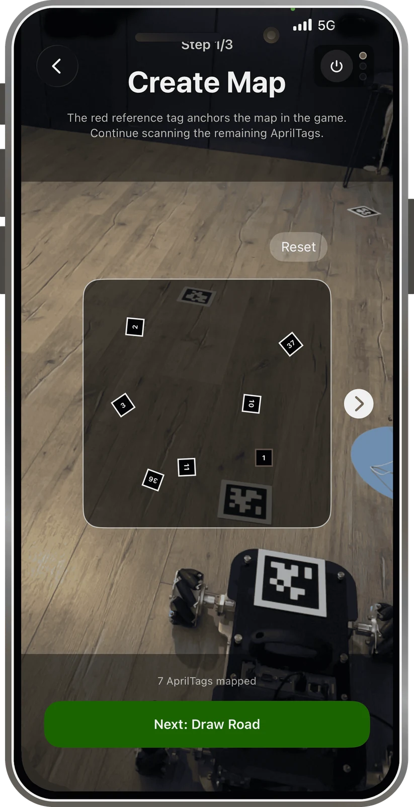

<figcaption>AprilTags erfassen und die Umgebung kartieren.</figcaption>
</figure>
<figure>

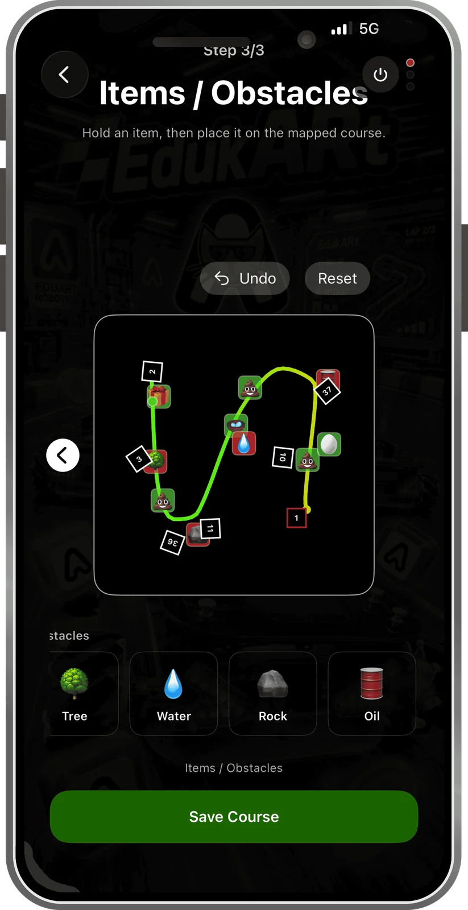

<figcaption>Die Strecke gestalten und Spielelemente platzieren.</figcaption>
</figure>

:::info Unterschiedliche Testversionen
In der ersten Testversion auf der Consumenta war die eigene Streckenerstellung deaktiviert. Dort standen drei vorbereitete Strecken zur Auswahl. Welche Möglichkeiten du nutzen kannst, hängt von deiner installierten Testversion ab.
:::

## 3. Die Strecke im Raum ausrichten

Scanne zum Spielstart **denselben Referenz-AprilTag, der beim Erstellen der Karte zuerst erkannt wurde**, erneut. Damit wird die gespeicherte Karte mit der Strecke im Raum platziert. Die zuvor befestigten Tags müssen dafür an ihren Positionen bleiben und dürfen sich nicht verdreht haben.

## 4. Das Rennen starten

Bringe deinen Roboter an den Start der ausgerichteten Strecke. Wenn du bereit bist, starte das Rennen mit **„I’m Ready“**.

Fahre durch die virtuelle Strecke und sammle die gewünschten Items ein. Bei einem echten Roboter wirken sich virtuelle Ereignisse auch auf seine reale Bewegung aus. Behalte deshalb beim Fahren sowohl den Bildschirm als auch den Roboter und seine Umgebung im Blick.

<figure>

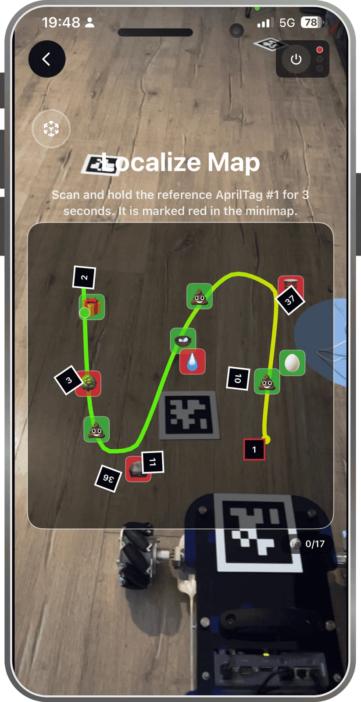

<figcaption>Die Strecke mit dem Referenz-AprilTag ausrichten.</figcaption>
</figure>
<figure>

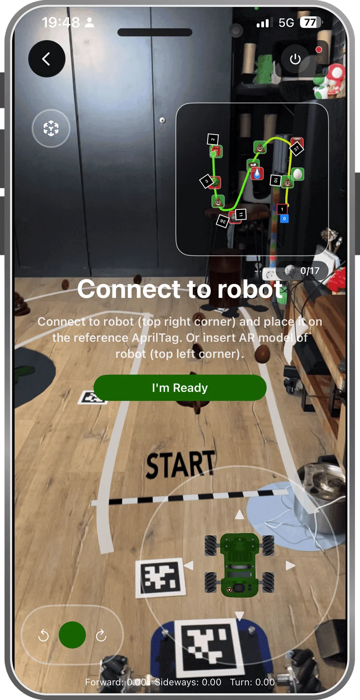

<figcaption>Den Roboter an den Start bringen und „I’m Ready“ wählen.</figcaption>
</figure>

## Robotersteuerung

Mit **„Robot Remote“** kannst du Eduard direkt steuern. Ein Joystick ist für die Bewegung zuständig, ein weiterer für die Drehung. Zusätzlich lassen sich Lichtfarben und Lichteffekte auswählen und das Kamerabild einblenden. Deine Fahrt kannst du mit der iOS-Bildschirmaufnahme festhalten.

<figure>

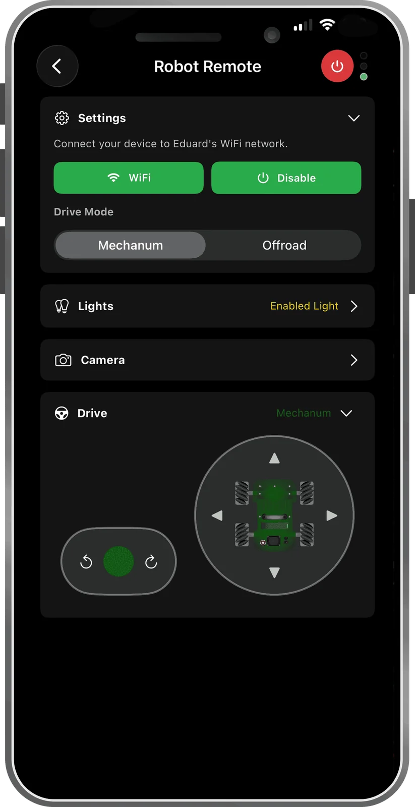

<figcaption>Robot Remote: Roboter verbunden und aktiviert.</figcaption>
</figure>
<figure>

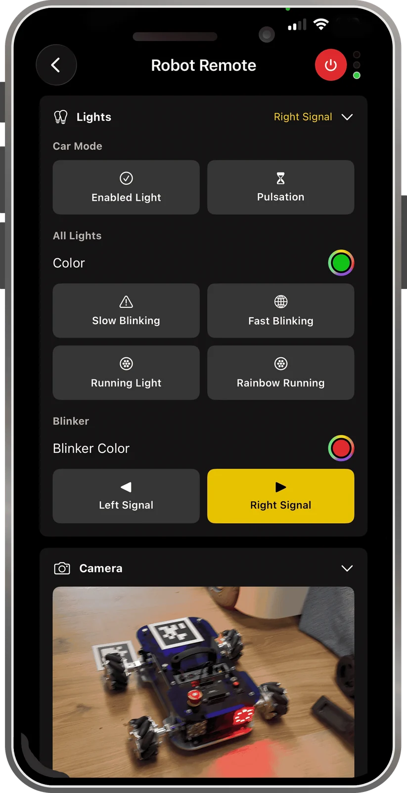

<figcaption>Lichtfarben und Effekte mit Livebild einstellen.</figcaption>
</figure>

## Items und Hindernisse

Die Tabelle fasst die Auswirkungen aus der [Bachelorarbeit, Tabellen 4.12 bis 4.19](./assets/files/EdukARt_Bachelorarbeit.pdf#page=56), zusammen. Die Prozentangaben beziehen sich auf die eingestellte Maximalgeschwindigkeit des Roboters. Im normalen Spielbetrieb fährt er mit **80 %**.

| Icon | Spielelement | Auswirkungen im Spiel | Licht am Roboter |
| :---: | --- | --- | --- |
| 🪙 | **Münze** | Erhöht die Geschwindigkeit für **2 Sekunden auf 90 %**. Weitere Münzen können den Boost verlängern. Jede nicht eingesammelte Münze zählt **5 Sekunden zur Endzeit** dazu. | Gelb, schnell blinkend für 0,55 Sekunden. |
| 🎁 | **Itembox** | Wird eingesammelt und verschwindet. Jede Box gibt einen **Zeitbonus von 20 Sekunden**. | Lila, schnell blinkend für 0,8 Sekunden. |
| 🥚 | **Ei** | Wird eingesammelt und vom Roboter zum Eierbecher transportiert. | Grün, schnell blinkend für 0,55 Sekunden. |
| 🪺 | **Eierbecher** | Nimmt die mitgebrachten Eier entgegen. Die Abgabe repariert simulierten Schaden und stellt die normale Spielgeschwindigkeit von **80 %** wieder her. | Grün, schnell blinkend für 1,5 Sekunden. |
| 💩 | **Shit** | Löst **5 Sekunden automatische Zickzackfahrt** bei reduzierter Geschwindigkeit aus. Währenddessen sind die Joysticks gesperrt. Das Item verschwindet und hinterlässt eine braune Spur. | Orange, schnell blinkend für 5 Sekunden. |
| 🌳 | **Baum** | Wächst beim Auslösen aus dem Boden und blockiert den Weg. Eine Kollision verringert die normale Spielgeschwindigkeit um **10 Prozentpunkte**. Pro Baum können erst nach 10 Sekunden erneut Schäden entstehen. | Beim Erscheinen grün, schnell blinkend für 3 Sekunden; bei Schaden dunkelrot, langsam blinkend für 0,8 Sekunden. |
| 💧 | **Wasser** | Aktiviert die Schwimmsteuerung: Vorwärts geht es mit kurzen Joystick-Bewegungen jeweils etwa **5 cm**, seitwärts weniger. Zwischen den Bewegungen muss der Joystick in die Neutralstellung zurückkehren. | Blau, schnell blinkend, solange der Wassermodus aktiv ist. |
| 🪨 | **Stein** | Blockiert die Bewegung in den Stein hinein. Eine Kollision verringert die normale Spielgeschwindigkeit um **10 Prozentpunkte**. Pro Stein können erst nach 10 Sekunden erneut Schäden entstehen. | Dunkelrot, langsam blinkend für 0,8 Sekunden. |
| 🛢️ | **Öl** | Dreht den Roboter **5 Sekunden automatisch auf der Stelle**; währenddessen sind die Joysticks gesperrt. Das Fass blockiert den Weg und kann bei einer Kollision **10 Prozentpunkte Geschwindigkeit** kosten. Zwischen Dreheffekten liegen mindestens 20 Sekunden, zwischen Schäden am selben Fass mindestens 10 Sekunden. | Hellrot, langsam blinkend für 5 Sekunden. |

Münzen werden automatisch entlang der Strecke platziert. Eingesammelte Items verschwinden aus der AR-Ansicht; Hindernisse bleiben auf der Strecke. Beim virtuellen AR-Roboter können einzelne Effekte, insbesondere die Schwimmsteuerung, noch abweichen.

Die folgenden Bilder zeigen jeweils das Spielelement auf der Strecke und die Interaktion im AR-Spiel.

### Münzen

Einsammeln erhöht die Geschwindigkeit für zwei Sekunden auf 90 %. Jede verpasste Münze zählt fünf Sekunden zur Endzeit dazu.

<figure>

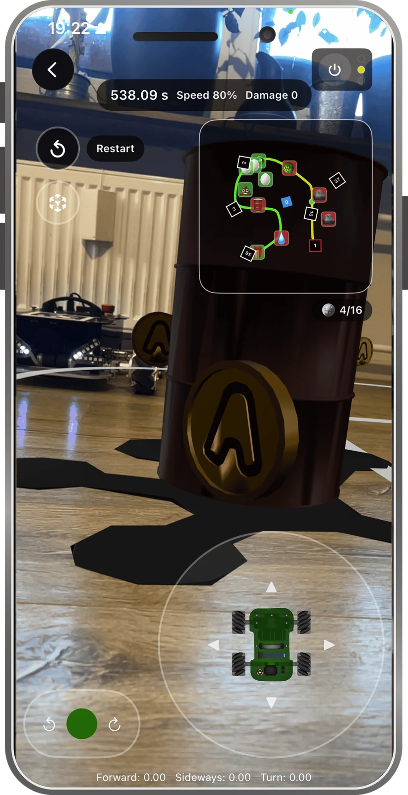

<figcaption>Münzen auf der Strecke.</figcaption>
</figure>
<figure>

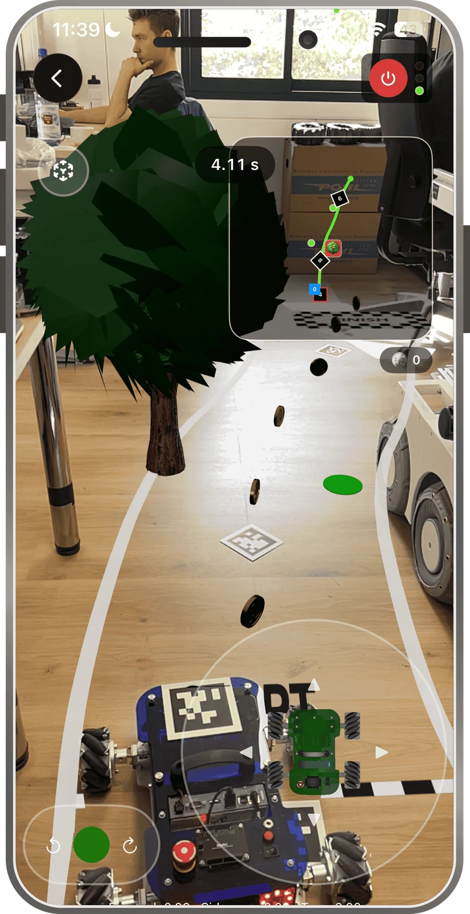

<figcaption>Münzen im AR-Spiel.</figcaption>
</figure>

### Itembox

Jede eingesammelte Box verringert deine Endzeit um 20 Sekunden.

<figure>

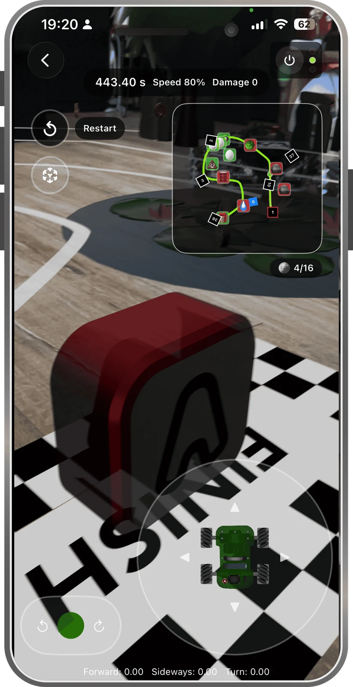

<figcaption>Itembox auf der Strecke.</figcaption>
</figure>
<figure>

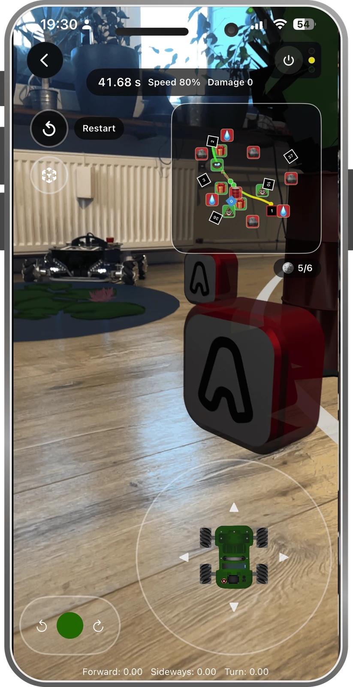

<figcaption>Itembox im AR-Spiel.</figcaption>
</figure>

### Ei und Eierbecher

Sammle Eier ein und bringe sie zum Eierbecher, um simulierten Schaden zu reparieren und die normale Spielgeschwindigkeit von 80 % wiederherzustellen.

<figure>

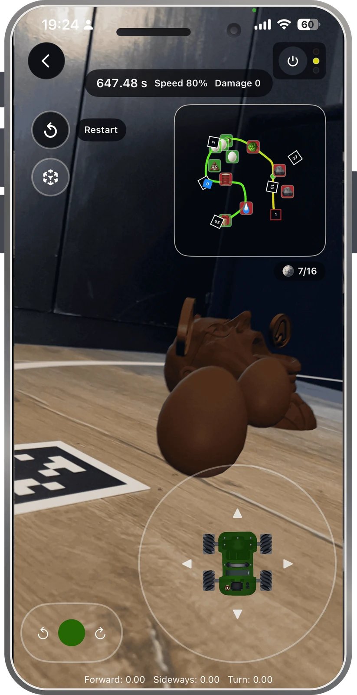

<figcaption>Ei und Cup auf der Strecke.</figcaption>
</figure>
<figure>

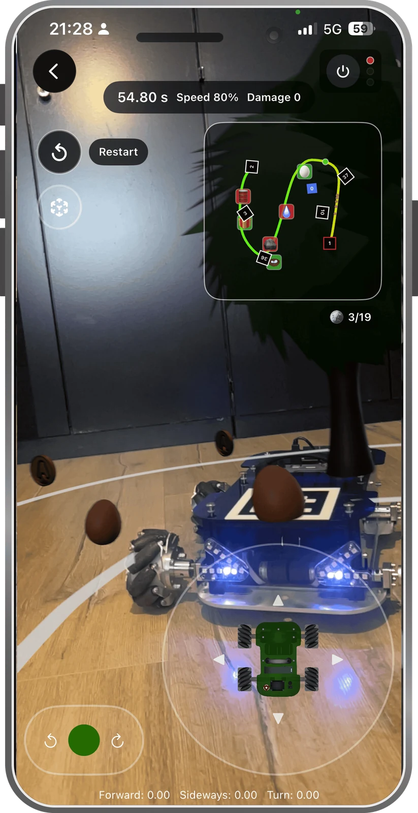

<figcaption>Ei und Cup im AR-Spiel.</figcaption>
</figure>

### Shit

Löst fünf Sekunden Zickzackfahrt aus und hinterlässt eine Spur.

<figure>

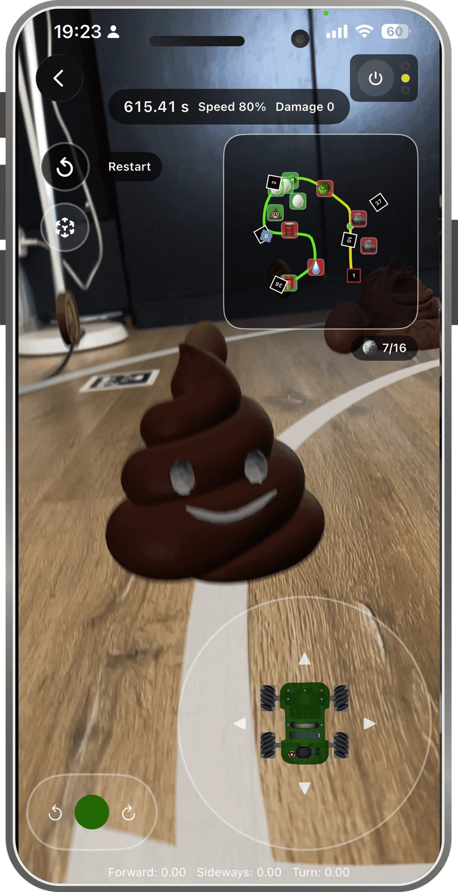

<figcaption>Shit auf der Strecke.</figcaption>
</figure>
<figure>

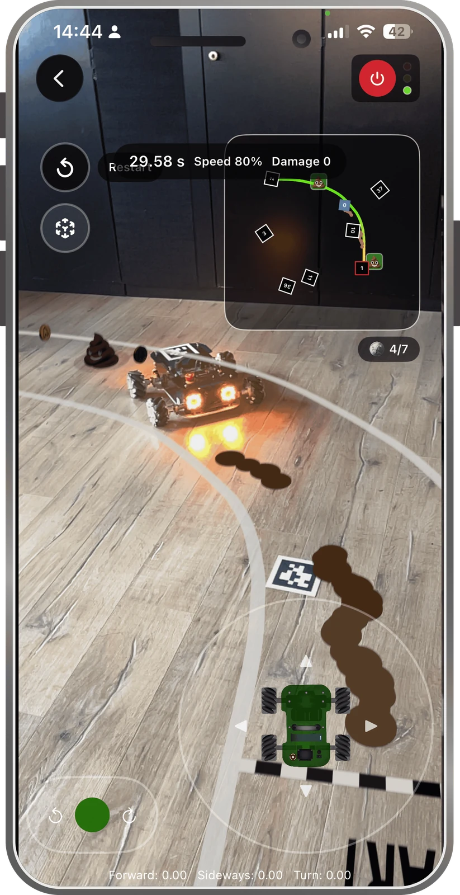

<figcaption>Shit im AR-Spiel.</figcaption>
</figure>

### Baum

Ein Hindernis, dem du ausweichen musst.

<figure>

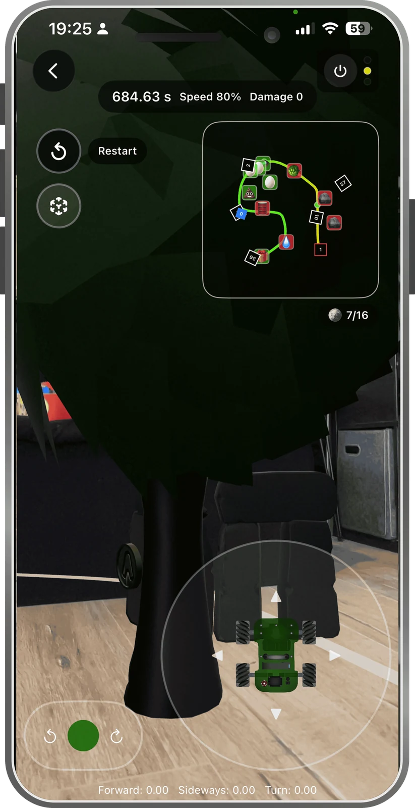

<figcaption>Baum auf der Strecke.</figcaption>
</figure>
<figure>

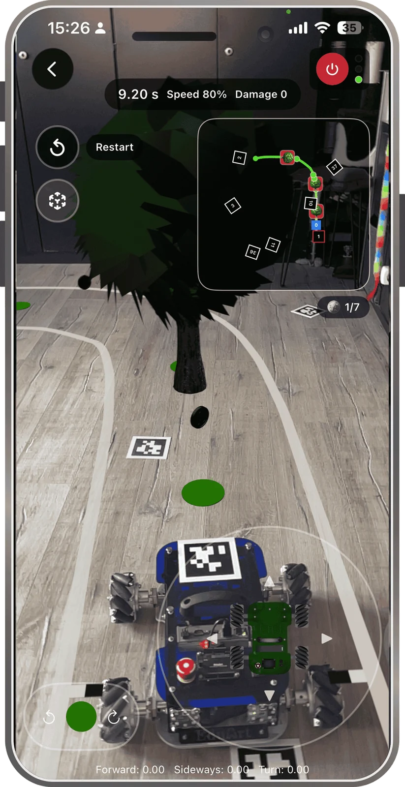

<figcaption>Baum im AR-Spiel.</figcaption>
</figure>

### Wasser

Mit kurzen Joystick-Bewegungen bewegst du dich hindurch.

<figure>

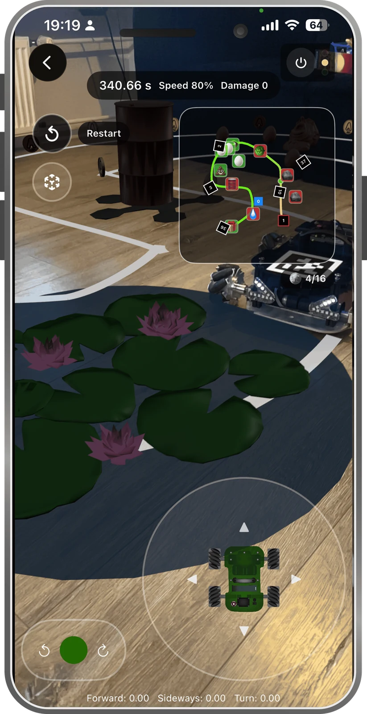

<figcaption>Wasser auf der Strecke.</figcaption>
</figure>
<figure>

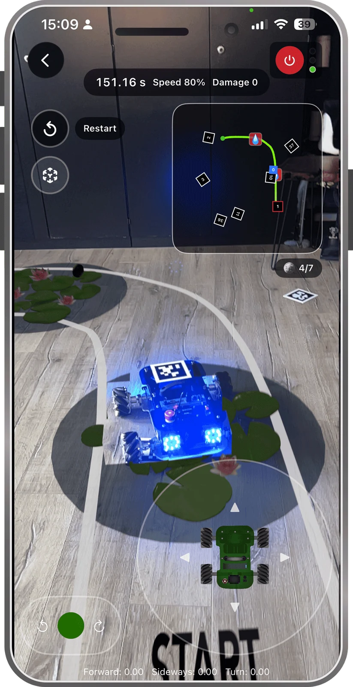

<figcaption>Wasser im AR-Spiel.</figcaption>
</figure>

### Stein

Ein virtuelles Hindernis, das deine Fahrt beeinflusst.

<figure>

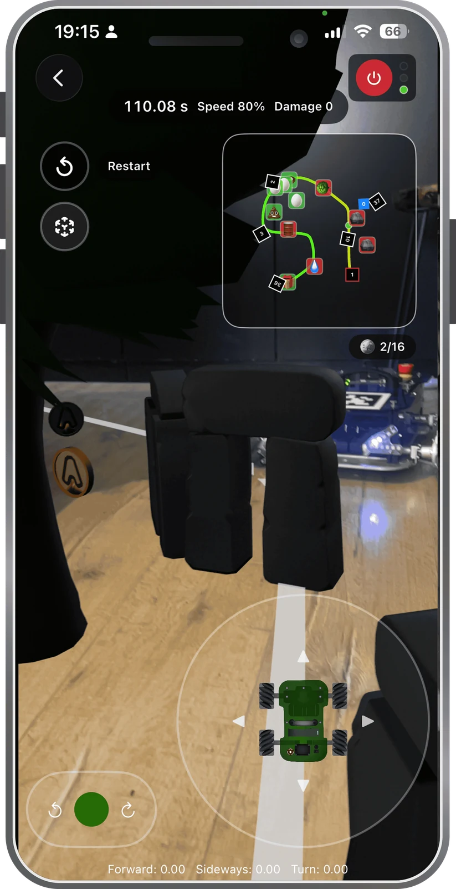

<figcaption>Stein auf der Strecke.</figcaption>
</figure>
<figure>

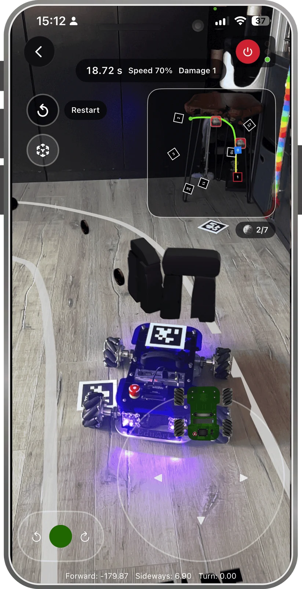

<figcaption>Stein im AR-Spiel.</figcaption>
</figure>

### Öl

Der Roboter dreht sich fünf Sekunden lang auf der Stelle.

<figure>

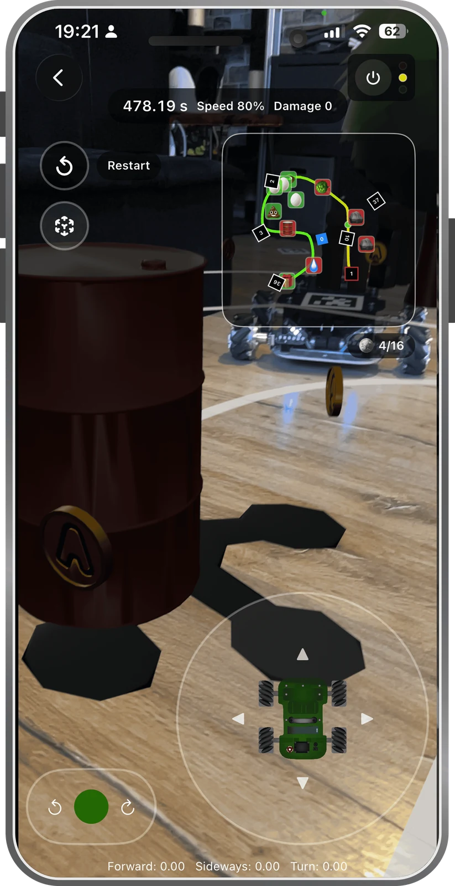

<figcaption>Öl auf der Strecke.</figcaption>
</figure>
<figure>

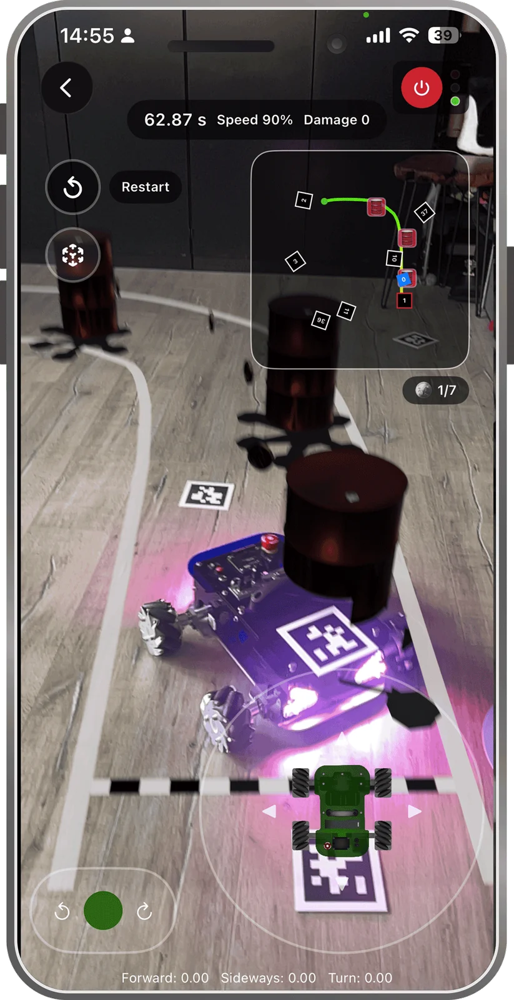

<figcaption>Öl im AR-Spiel.</figcaption>
</figure>

## Feedback geben

EdukARt wird weiterentwickelt. Teile Fehler und Wünsche über TestFlight oder beschreibe dein Spielerlebnis in der [Online-Umfrage](https://www.umfrageonline.com/c/btxxap4r).

Videos und weitere Einblicke ins Gameplay findest du auf der [EdukARt-Projektwebsite](https://sinamatic.de/edukart/).
