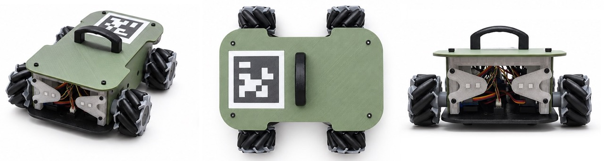

import styles from './edukart.module.css';

# Baue deinen Roboter

<figure className={styles.robotPhoto}>

<figcaption>So soll dein eigener Roboter für EdukARt aussehen.</figcaption>
</figure>

Der aktuelle Plan ist, einen **größtenteils aus 3D-gedruckten Teilen bestehenden Roboter** zu bauen, wie du ihn oben auf dem Foto siehst. Damit sollst du dir deinen eigenen echten Roboter für EdukARt nachbauen können.

## Woran gerade gearbeitet wird

Aktuell wird mit dem **Cyberbrick-Kit von Bambu** experimentiert. Dabei wird versucht, den zugrunde liegenden **ESP32 als Basis für die Robotersteuerung** zu verwenden. Aufbau, Steuerung und die Anbindung an das Spiel befinden sich noch in Entwicklung.

## Das findest du bald hier

Sobald der Aufbau zum Nachbauen bereit ist, werden auf dieser Website die nötigen Dateien und Anleitungen veröffentlicht:

- **3D-Druckdateien**, mit denen du die Roboterteile selbst ausdrucken kannst,
- das **Softwareimage für den ESP32**,
- eine **Bau- und Inbetriebnahmeanleitung**,
- eine **Anleitung zur Integration deines eigenen Roboters in EdukARt**.

Neuigkeiten zum Projekt findest du auch auf der [EdukARt-Website von Sinamatic](https://sinamatic.de/edukart/).

## Du hast schon einen Roboter?

Wenn du bereits einen ROS2-Roboter besitzt, findest du unter [Eigenen Roboter verwenden](./4_edukart-eigenen-roboter-verwenden.md) Informationen zur Anbindung über die ROS2-Python-Bridge und zur geplanten Konfiguration in der App.

## Schon jetzt spielen

EdukARt lässt sich bereits mit dem **AR-Roboter im Spiel** ausprobieren. Außerdem wird die echte **R&D Plattform Eduard** verwendet.

Beginne mit der [Installation der Testversion](./2_edukart-spielanleitung.md#spiel-installieren) und folge anschließend der [Spielanleitung](./2_edukart-spielanleitung.md).
